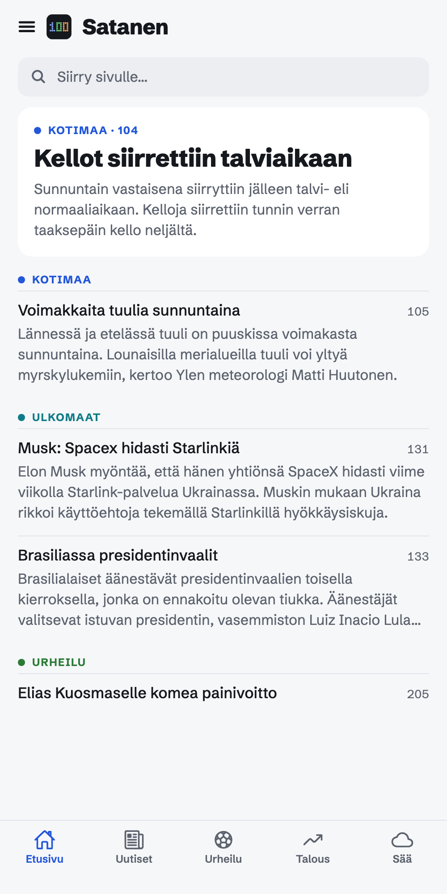
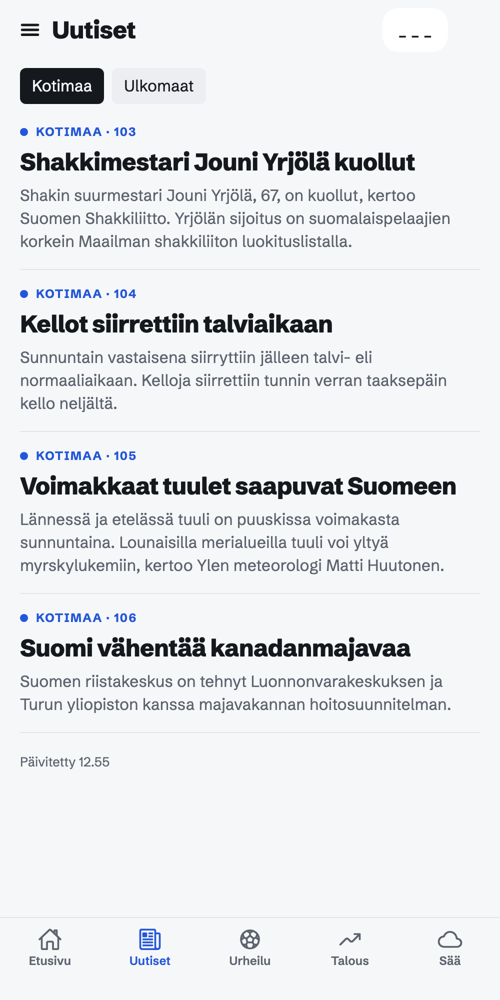
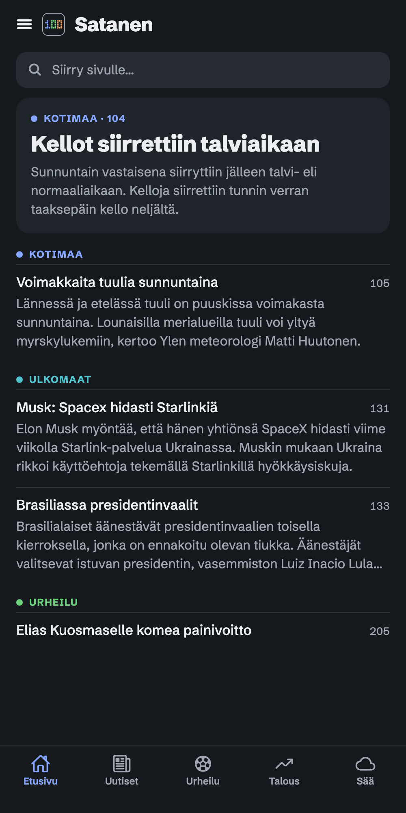
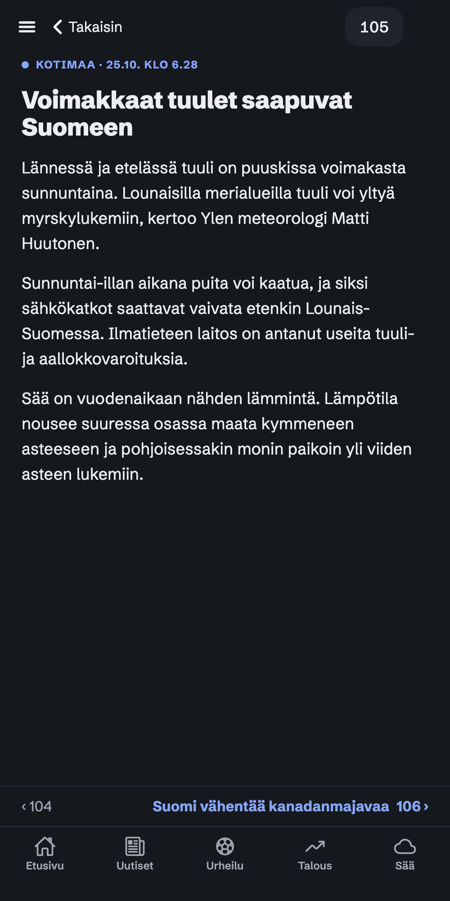

<p align="center">
  
</p>

# Satanen

[](https://github.com/mettala/satanen/actions/workflows/ci.yml)

A calm, modern reader for **Yle Teksti-TV** (Finnish teletext) on the web, phone app stores later. Named after page 100, where teletext always starts.

- Live at **[satanen.io](https://satanen.io)**
- Status: version 1.0.0 of the web app is live. Android (Play Store) is next, possibly iPhone (App Store) later.
- Independent app, not made or endorsed by Yle. Content: Yle Teksti-TV, via Yle's public API.

## Why

Teletext is fast, calm and to the point. Satanen gives it an interface that feels familiar to younger readers used to news apps, while keeping the page numbers and structure that long-time teletext readers know. It is very fast, has no ads and no photos, and sets no cookies. The aim is an efficient way to read the most important news briefly, without the addictive "doom scrolling" of modern platforms.

- Free and non-commercial: no ads, no payments, no other monetisation, no accounts.
- Yle's content is never reworded or added to. Pages are only re-laid out for a small screen.

## What it does

Satanen fetches teletext pages from Yle's public API and shows them as a news app instead of a 40×24 character grid: sections, headline lists, scrolling articles and tappable page links.

- Front page with the top story and the latest headlines per section
- Feeds for Uutiset (Kotimaa and Ulkomaat) and Talous; Urheilu opens the sports front page, with the feed of sports stories behind a button; Sää is Yle's weather page
- Articles in a readable column, with previous and next page at the bottom
- "Siirry sivulle" field: type a page number or a section name
- Recently read pages, offline copies of pages you have opened, and "Päivitetty" times
- Light and dark theme that follow the device theme, text that follows the phone's font size
- No accounts, no cookies, no ads. Only counts of opened pages are made, by the proxy, with a daily visitor code that changes every day.

## Screenshots

From the live site, on a phone-sized screen.

<table>
  <tr>
    <td align="center"><br>Front page</td>
    <td align="center"><br>News feed</td>
    <td align="center"><br>Dark theme</td>
    <td align="center"><br>Article</td>
  </tr>
</table>

The icon is the number 100 in rounded teletext blocks, one section colour per digit, on graphite. Source files: `design-system/assets/Logos/`. The app icons are in `assets/` and `public/icons/`.

## Licence

The source code is under the [MIT licence](LICENSE). Yle content (fixtures and screenshots of Yle pages) is © Yle and is not covered by it; see [NOTICE.md](NOTICE.md). The app's content comes from Yle's public API and is credited in the app as "Sisältö: Yle Teksti-TV".

## How it fits together

```
Phone or browser ──► Satanen app (Expo, React Native)
                          │
                          ▼
                     Proxy (Cloudflare Worker, api.satanen.io)
                     holds the Yle key, caches each page
                          │
                          ▼
                     Yle Teksti-TV API
```

- **App** (`app/`, `src/`): Expo + TypeScript + expo-router. One codebase for web, Android and iOS. The parser in `src/parser/` turns Yle's JSON into reader blocks and is tested against saved pages in `fixtures/`.
- **Proxy** (`proxy/`): the only part that knows the Yle API key. See `proxy/README.md`.
- **Web hosting** (`site/`): Cloudflare serves the static web build on `satanen.io`.

## What's in this repo

| Path                   | What                                                                                                                                                                                                                                           |
| ---------------------- | ---------------------------------------------------------------------------------------------------------------------------------------------------------------------------------------------------------------------------------------------- |
| `AGENTS.md`            | Brief for coding agents (T3 Code, Claude Code, Codex): stack, rules, conventions. Read first.                                                                                                                                                  |
| `app/`                 | Screens (expo-router)                                                                                                                                                                                                                          |
| `src/`                 | App code: API client, parser, feeds, UI components, storage, theme, Finnish strings                                                                                                                                                            |
| `proxy/`               | Cloudflare Worker that talks to Yle                                                                                                                                                                                                            |
| `site/`, `public/`     | Web hosting config, install manifest and icons                                                                                                                                                                                                 |
| `fixtures/`            | Real Yle responses saved for parser tests                                                                                                                                                                                                      |
| `docs/maintainer/`     | Owner runbooks: `DEPLOY.md` (deploy and roll back), `EMERGENCY.md` (stop the agents, roll back the site, stop the proxy, revoke tokens), `OWNER-TEST.md` (test the live site on your Mac and phone), `OWNER-CHECKLIST.md` (Google Play steps). |
| `docs/AGENT-PLAN.md`   | How agents build the app: roles, models, workflow, milestones. `docs/BACKLOG.md` is the live task list, `docs/DECISIONS.md` the decision log.                                                                                                  |
| `docs/HOW-WE-BUILD.md` | How the project is built with agents, including what went wrong.                                                                                                                                                                               |
| `docs/PLAN.md`         | Product scope, tech stack, phases, release steps, risks                                                                                                                                                                                        |
| `docs/YLE-API.md`      | How Yle's teletext API works and how pages become reader-mode content                                                                                                                                                                          |
| `docs/DESIGN.md`       | Every design decision made so far, and why                                                                                                                                                                                                     |
| `docs/store/`          | Play Store listing and privacy policy drafts                                                                                                                                                                                                   |
| `design-system/`       | Tokens (`tokens.json`), brand book (`README.md`), component guidelines + HTML previews, logo files                                                                                                                                             |
| `design/screens/`      | Source of the final mock-ups (front page, jump sheet, drawer, favourites, article, states, logo)                                                                                                                                               |
| `.env.example`         | The environment variables the proxy needs. `.env` holds public settings, `.env.fixtures` the secrets; never commit either.                                                                                                                     |

## Development

Requires Node 24 (see `.nvmrc`). Install dependencies once:

```sh
npm install
```

Run the web app (development server):

```sh
npm run web
```

Run all checks (typecheck, lint, formatting and tests):

```sh
npm run typecheck
npm run lint
npm run format:check
npm test
```

The app reads pages through the proxy. To run it locally, copy `.env.example` to `.env` (public settings only; keep the proxy address) and to `.env.fixtures` (your own Yle keys and Cloudflare stats values; delete the lines that do not belong in each file), and start the proxy in a second terminal (`npm --prefix proxy run dev`, serves on `localhost:8787`). See `proxy/README.md`.

A production web build is made with `npm run build:web`.

## Putting the web app online (satanen.io)

The web app is a set of plain files that Cloudflare hands out; there is no server code to run. Anything the app does not recognise (for example `/105`) gets the same page, and the app then shows that teletext page.

Once, before the first deploy: install the proxy's tools (`cd proxy && npm install`) and log in with `proxy/node_modules/.bin/wrangler login`. `satanen.io` must be a site in the same Cloudflare account.

- `npm run deploy:web` first runs a release guard (clean tree, on `main`, equal to `origin/main`, CI green), then builds the app and publishes it. To go back to an earlier version, use `wrangler rollback` (see `docs/maintainer/DEPLOY.md`).
- `npm run smoke:web` checks the live site: the front page and `/105` open, the install manifest and offline worker are served, files are cached the right way and missing script files answer 404. Give another address to test somewhere else, for example `npm run smoke:web -- http://localhost:8787`.
- To try it on your own computer first: `npm run build:web`, then `proxy/node_modules/.bin/wrangler dev -c site/wrangler.toml`.

The site can be found by search engines (the `noindex` header of decision D20 was removed for version 1.0.0, D52). Only the front page is listed (D53): the worker in `site/src/index.mjs` adds `X-Robots-Tag: noindex` to every other path, because those pages show Yle's news text. `public/robots.txt` and `public/sitemap.xml` point crawlers at the front page, and `public/index.html` carries the title, description and the Open Graph tags that make a shared link show a card (the image is `public/og-image.png`, see `assets/README.md`). To let numbered pages be listed too, remove the `noindex` lines in the worker and in `scripts/smoke-web.mjs`.

## Live design files

- Mock-up canvas (all rounds + final screens): [https://claude.ai/artifact/7HSA5gVi6wTzhi4o3YLQZ6](https://claude.ai/artifact/7HSA5gVi6wTzhi4o3YLQZ6#page-6b740af91e1b)
- Design system: https://claude.ai/artifact/SkTDC9RimCjqH9GTRwgL24
